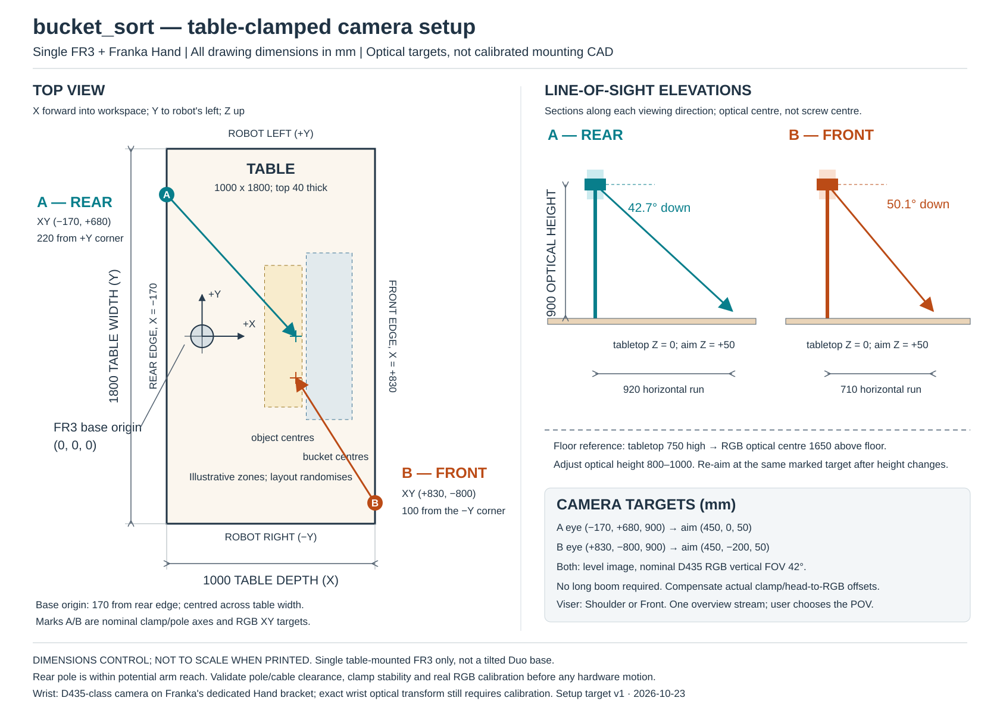

# Bucket sort: real-world camera setup targets

This layout reproduces `bucket_sort` with **one table-mounted FR3 and its Franka Hand**. It is not a tilted FR3 Duo layout. The two overview positions match Viser's **Shoulder** and **Front** choices; neither POV is mandatory.

## Reference frame and table

Measure from the centre of the FR3 base on the tabletop, not from a table corner or either arm of a Duo:

- **+X:** from the robot into the work area.
- **+Y:** the robot's left, when looking into the work area from behind it.
- **+Z:** vertically upward; tabletop is Z = 0.
- Table: **1000 mm along X × 1800 mm along Y**, **40 mm thick**.
- Rear edge: **X = −170 mm**. Front edge: **X = +830 mm**.
- Left/right long edges: **Y = +900 / −900 mm**. The base is centred across the width.
- Simulated table height: **750 mm above the floor**. Use your measured table height for the real floor reference.

These are the simulated cell dimensions, not measurements of your real table. If the real table or base placement differs, update the simulated layout and mounting targets before comparing camera views.

## Overview poles and optical targets

Both cameras use an adjustable **0.8–1.0 m table-clamped pole**, with the **RGB optical centre at 900 mm above the tabletop** as the nominal setup. No long horizontal boom is required. A compact head or short adapter is sufficient; account for its offset when placing the RGB optical centre.

| Viser choice        | Edge and nominal pole/clamp XY, mm | RGB optical-centre XYZ, mm | Aim XYZ, mm       | Downward tilt |
| ------------------- | ---------------------------------- | -------------------------- | ----------------- | ------------- |
| Shoulder / rear (A) | Rear edge: `(-170, +680)`          | `(-170, +680, 900)`        | `(450, 0, 50)`    | **42.7°**     |
| Front (B)           | Front edge: `(+830, -800)`         | `(+830, -800, 900)`        | `(450, -200, 50)` | **50.1°**     |

Practical tape-measure references:

- **Rear A:** clamp on the rear edge, **220 mm from the robot-left corner** toward the centre. This follows the approved green-marked screenshot; its coordinates were inferred from the diagram, not measured on hardware.
- **Front B:** clamp on the front edge, **100 mm from the robot-right corner** toward the centre. It sits farther toward the corner than a direct mirror of A so nearby bucket edges fit.
- Keep the image level (**zero roll**). Point the camera at the listed aim marker; this sets yaw without ambiguous Euler-angle conventions. Both aim markers are **50 mm above the tabletop**.
- If the table is 750 mm high, the nominal optical centre is **1650 mm above the floor**; the 800–1000 mm adjustment range becomes 1550–1750 mm above the floor.
- **900 mm is an optical height, not a mast cut length.** Subtract the clamp/head-to-RGB vertical offset when setting the pole. Measure horizontal sensor offsets too: a mounting screw is not the RGB optical origin.

The upper arm is intentionally outside these task-focused views. The placement targets keep the task objects and complete buckets framed, rather than attempting to include the whole arm with a short pole. Height changes require re-aiming at the same marker; the virtual defaults use 900 mm.

The simulator exposes **one `overview` stream**, repositioned by the selector. For a real setup, either move one camera/pole between the two marked positions, or install two overview cameras and explicitly select the corresponding physical stream. Do not silently swap views or change camera keys between demonstrations and deployment.

## Hardware checklist

- One FR3 with Franka Hand, mounted according to Franka's requirements. This diagram does not specify the robot's structural anchoring.
- **One or two D435-class overview cameras** and rigid, locking table-clamp pole assemblies. Two cameras are optional; the two locations are alternative POVs, not a requirement to feed both images to the policy.
- One wrist D435/D435i on the **dedicated Franka RealSense Hand bracket**, following the [manufacturer guide](https://franka.de/hubfs/3D%20Printable%20Camera%20Mount%20Guide.pdf?hsLang=en).
- D435 camera plate using its **1/4-20 UNC thread** or **two M3 mounting points**, with anti-rotation restraint. Use the [manufacturer mechanical specifications](https://store.realsenseai.com/buy-intel-realsense-depth-camera-d435.html) for hole geometry and permissible screw engagement; screw length depends on the plate stack-up.
- A clamp rated for the actual table thickness and loads. The simulated top is 40 mm thick; allow for pads and verify support/frame clearance beneath both proposed clamp points.
- USB cables, rigid-support strain relief and suitable wrist service loops. Keep cables, clamps and poles clear of robot and gripper motion. Do not let a cable pull the camera head away from its calibration.

## Setup and calibration sequence

1. **With robot motion disabled**, measure the table, locate the base origin and mark the axes. Check both clamp locations for solid material and unobstructed jaw engagement.
2. Clamp and lock the support. Measure the **RGB optical centre**, accounting for the real camera/head offsets, and set its height to 900 mm above the tabletop.
3. Place a temporary marker at the appropriate XYZ aim point using a 50 mm riser. Aim and level the camera; remove the marker before task recording.
4. Select the physical RGB stream profile. The previews use nominal **42° vertical FOV**; D435's nominal full RGB FOV is about **69° × 42°**, not the depth sensor's 87° × 58°.
5. Read the stream's actual `fx`, `fy`, `ppx`, `ppy` and distortion from RealSense. Match the real and virtual aspect ratio, intrinsics and policy resizing/letterboxing. The simulator's built-in stream is 640×480 unless configured otherwise; a 16:9 stream has a wider horizontal view at the same nominal vertical FOV.
6. Calibrate the fixed camera-to-base transform and verify it against targets spanning the work area. Calibrate the wrist hand-to-RGB optical transform separately. **The generic wrist optical pose is still unverified against the printed mount; the schematic does not certify it.**
7. **Before enabling hardware motion**, validate the complete pole, clamp and cable swept-volume clearance, stability and emergency-stop access using the cell's safety procedure. The rear pole is only about **0.70 m horizontally from the robot base**, within potential arm reach.
8. Choose **Shoulder** or **Front** in Viser (or `--overview shoulder` / `--overview front`). Keep the matching physical view and preprocessing fixed for recording, evaluation and deployment.

## What was checked, and what was not

- Geometric framing was checked for **100 reset layouts at each of 0.8, 0.9 and 1.0 m**, using nominal D435 RGB optics and complete task mesh vertices. Rear worst margins at 640×480 were about **16 / 36 / 54 px**; front about **20 / 28 / 29 px**.
- Images were inspected for three reset layouts in both views; the renderer's visible-pixel counts check that task bodies appear in those specific images. This is not proof of full visibility during motion or inside every bucket.
- There has been **no hardware actuation or real camera calibration**, no full-trajectory pole/cable collision validation, and no structural verification of the proposed clamps. The camera poses and diagram are installation targets, not a safety-certified mechanical drawing.
